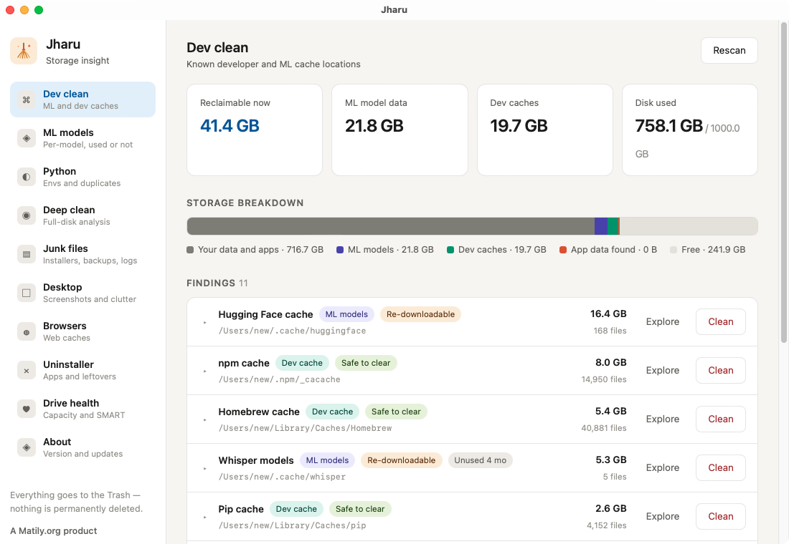

<div align="center">


# Jharu

**Free, open source disk cleaner and storage analyzer for developers — macOS and Windows**

Jharu finds and safely removes the gigabytes that development tools leave behind: machine learning model caches, package manager caches, Docker data, leftovers from uninstalled apps, and forgotten junk files — all from one professional dashboard.

[](https://github.com/riponcm/Jharu/stargazers)
[](https://github.com/riponcm/Jharu/releases)
[](LICENSE)
[](#installation)
[](https://tauri.app)



</div>

## What is Jharu?

Jharu is a desktop disk cleanup app built specifically for software developers and machine learning engineers. Generic disk space analyzers show you folder sizes; Jharu understands what the data actually is. It ships a knowledge base of known cache and data locations, classifies everything it finds, explains each item in plain language, rates how safe it is to delete, and moves removed data to the Trash or Recycle Bin — never a permanent delete.

Typical problems Jharu solves:

- Disk full after downloading machine learning models with Hugging Face, Ollama, PyTorch, or Whisper
- Gigabytes hidden in npm, pip, uv, yarn, pnpm, conda, Cargo, Go, Gradle, Maven, and NuGet caches
- Leftover settings, caches, and support files from apps you uninstalled long ago
- Old installers, phone backups, logs, and large files you have not touched in months
- Not knowing what is actually using your disk space

## Screenshots

<div align="center">

</div>

## Features

**Dev clean.**
Scans 25+ known developer and machine learning cache locations — Hugging Face, Ollama, PyTorch, Whisper, LM Studio, conda, pip, uv, npm, yarn, pnpm, Cargo, Go modules, Gradle, Maven, NuGet, Homebrew, Xcode DerivedData, Docker, JetBrains, Playwright, Puppeteer — with per-item safety ratings and staleness detection.

**Deep clean.**
Full-disk analysis with progressive results. Every folder is classified as system, applications, your files, app data, or developer data. System locations are marked protected and can never be cleaned from the app.

**Junk files.**
Finds non-cache junk: installers and archives in Downloads, old iPhone and iPad backups, logs and crash reports, mail attachment copies, and large files untouched for six months or more.

**Browsers.**
Detects Chrome, Edge, Brave, Arc, Firefox, and Safari, and itemizes their caches per profile, separating safe-to-clear cache from data that deserves review.

**Uninstaller.**
Lists installed applications with both their bundle size and the data they have accumulated across the system. Removing an app also finds and removes its leftovers, with high-confidence matches preselected.

**Drive health.**
Capacity, file system, and SMART status for every mounted drive, with usage gauges and early warnings as disks approach full.

**In-app updates.**
Jharu checks GitHub releases for new versions and downloads and installs them from inside the app — signed, verified, and with a one-click restart.

## What can Jharu clean?

| Category | Examples |
| --- | --- |
| ML model caches | Hugging Face hub (`~/.cache/huggingface`), Ollama models (`~/.ollama/models`), PyTorch hub, Whisper, Keras, LM Studio |
| Python | pip cache, uv cache, conda package cache, stale conda environments |
| JavaScript | npm cache (`~/.npm/_cacache`), yarn cache, pnpm store, Puppeteer and Playwright browser downloads |
| Build tools | Xcode DerivedData and archives, Gradle caches, Maven repository, Cargo registry, Go module cache, NuGet packages |
| Containers | Docker VM data and image storage |
| IDEs | JetBrains caches, editor cache directories |
| App leftovers | Support files, caches, preferences, and logs from uninstalled applications |
| Junk | Installers in Downloads, old device backups, crash reports, mail attachment copies, large stale files |

## Safety model

- Nothing is ever permanently deleted. Every clean action moves data to the Trash or Recycle Bin, where it can be restored.
- Every finding carries a safety rating: safe to clear, re-downloadable, or review first.
- Operating system locations are protected and excluded from cleaning entirely.
- Every destructive action requires an explicit in-app confirmation.

## Installation

Prebuilt installers for macOS (Apple Silicon and Intel) and Windows are published on the [releases page](https://github.com/riponcm/Jharu/releases). Once installed, Jharu updates itself in-app.

### Build from source

Prerequisites: [Rust](https://rustup.rs) (stable) and [Node.js](https://nodejs.org) 20+.

```sh
git clone https://github.com/riponcm/Jharu.git
cd Jharu
npm install
npm run tauri dev      # run in development
npm run tauri build    # produce installers for your platform
```

On macOS, grant Full Disk Access (System Settings, Privacy and Security) for complete scan coverage. Jharu detects missing access and offers to open the right settings pane.

### Opening Jharu the first time

Jharu is not yet signed with a paid developer certificate (see [Support Jharu](#support-jharu) below), so your operating system shows a one-time warning the first time you open it. This is expected for open source apps and does not mean anything is wrong — the download is verified by a cryptographic signature on every in-app update.

- **macOS:** if you see "Jharu cannot be opened because Apple cannot verify it", right-click (or Control-click) the app and choose **Open**, then confirm. You only do this once.
- **Windows:** if SmartScreen shows "Windows protected your PC", click **More info**, then **Run anyway**.

## Frequently asked questions

**How do I clear the Hugging Face model cache?**
Open Jharu's Dev clean tab. It lists your Hugging Face hub cache (`~/.cache/huggingface`) with its exact size and lets you explore it or move it to the Trash. Models are re-downloaded automatically the next time a library requests them.

**Is it safe to delete npm, pip, or other package manager caches?**
Yes. These caches only speed up reinstalls and are rebuilt automatically on the next install. Jharu marks them "Safe to clear". Deleting an active project's `node_modules` or a conda environment you still use is different — Jharu rates those "Review first".

**Does Jharu permanently delete my files?**
No. Every clean action moves data to the macOS Trash or Windows Recycle Bin, where it can be restored. Jharu never bypasses the Trash.

**Is Jharu a free alternative to CleanMyMac or CCleaner?**
Yes. Jharu is free and open source under the Apache 2.0 license, with no subscription, telemetry, or upsell. Its focus is narrower and deeper: developer and machine learning data that general-purpose cleaners do not understand.

**How do I find out what is taking up disk space on my Mac or Windows PC?**
Jharu's Deep clean tab analyzes the whole disk and shows every folder's real size, classified by what it is — system files, applications, your documents, app data, or developer data — so you can tell junk from data that matters.

**How do I completely uninstall an app, including leftover files?**
Jharu's Uninstaller lists every installed app together with the data it has accumulated. Uninstalling removes the app and its leftover support files, caches, and preferences in one step.

## Architecture

| Layer | Technology |
| --- | --- |
| Scanner | Rust with parallel directory walking (`jwalk`) |
| Safety | OS trash integration (`trash`), never permanent deletion |
| Rules | Per-platform knowledge base of cache and data locations |
| UI | React and TypeScript, Tauri 2 WebView |
| Updates | `tauri-plugin-updater` with signed GitHub release artifacts |
| Drive info | `sysinfo` with SMART status via platform tools |

## Roadmap

- Windows uninstaller support via registry uninstall keys
- Orphaned-data detection by comparing leftover folders against installed applications
- Treemap visualization for deep clean
- Duplicate file detection
- Localized UI, starting with Bengali and Hindi

## Support Jharu

Jharu is free, open source, and has no ads, telemetry, or paid tier — and it always will. But shipping a desktop app that users can install without scary security warnings costs real money every year, and that is the one thing an individual developer cannot absorb alone:

| What it unlocks | Cost |
| --- | --- |
| **Apple notarization** — removes the "Apple cannot verify this app" warning on every Mac | 99 USD / year (Apple Developer Program) |
| **Windows code signing** — removes the "Windows protected your PC" SmartScreen warning | ~100–400 USD / year (code signing certificate) |

Every star and every sponsorship goes directly toward these costs. If Jharu reclaimed gigabytes of your disk, here is how you can pay it forward in seconds:

- **Star the repository.** It is free, it takes one click, and it is the single biggest thing that helps other developers discover Jharu.
- **Sponsor the project.** Even a one-time contribution the size of a coffee helps cover the signing certificates that make Jharu safe and frictionless for everyone to install. Use the **Sponsor** button at the top of this repository.
- **Spread the word.** Share Jharu with a teammate whose disk is always full, or post about it — reach is what turns a side project into a maintained tool.

Once the signing costs are covered, every release will install cleanly on macOS and Windows with no warnings at all. Thank you for helping keep Jharu free and independent.

## Contributing

Issues and pull requests are welcome. For substantial changes, open an issue first to discuss the approach. New cache locations for the knowledge base are especially appreciated — include the path per platform, what writes it, and whether it regenerates.

## License

Licensed under the [Apache License 2.0](LICENSE).

## Acknowledgements

Jharu draws inspiration from the open source projects ClearDisk, Pearcleaner, PureMac, SquirrelDisk, and kondo.

---

<div align="center">

A [Matily.org](https://matily.org) product. Built with Projectmem memory.

</div>
