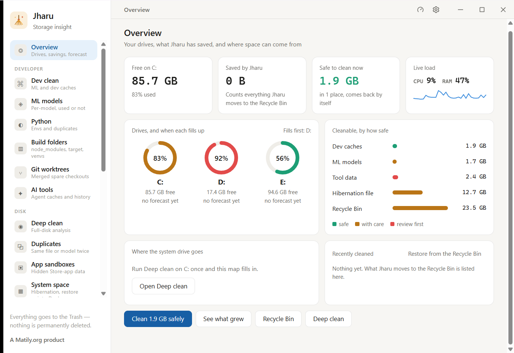
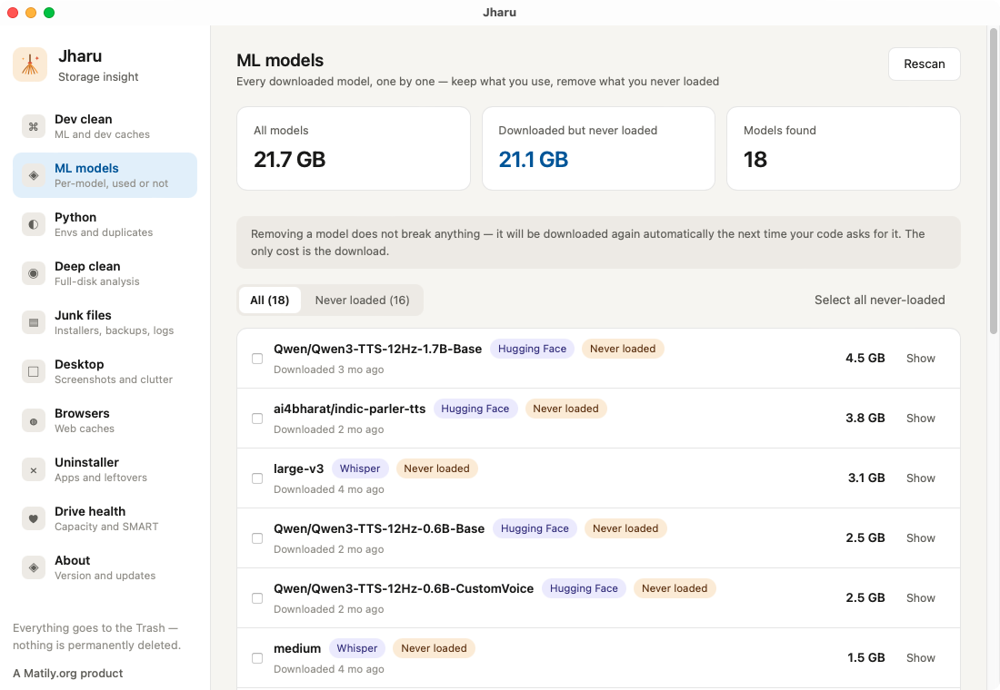
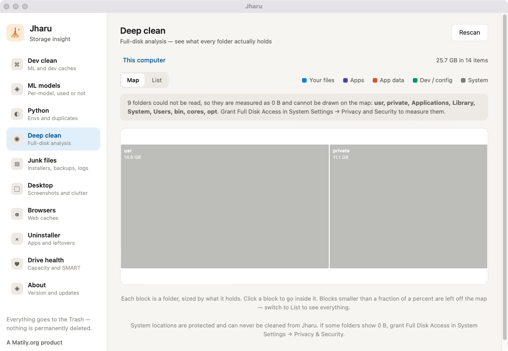
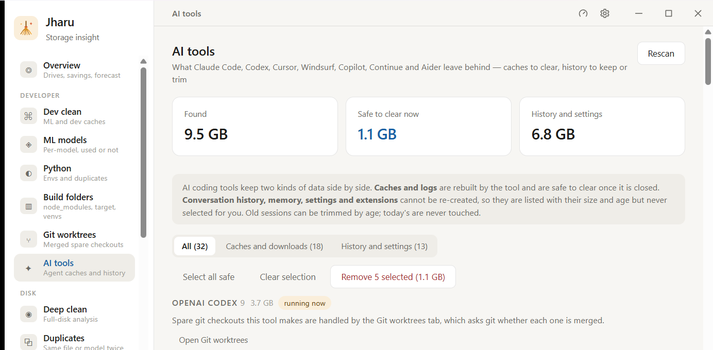
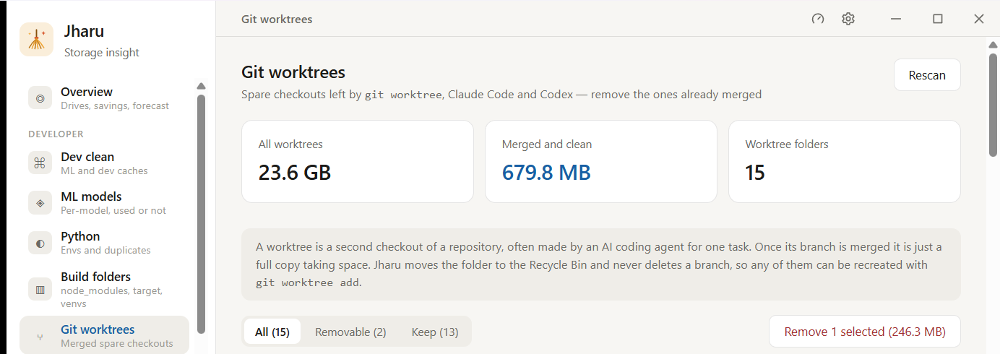
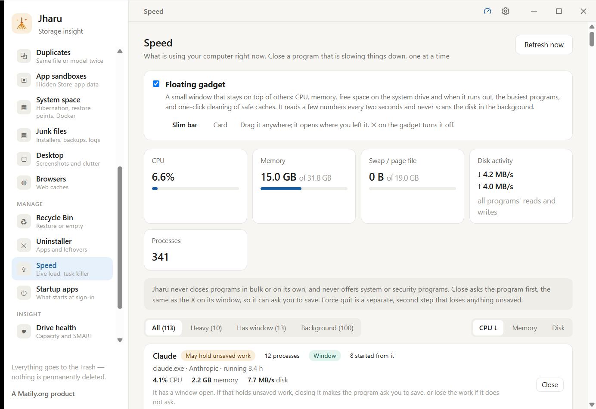
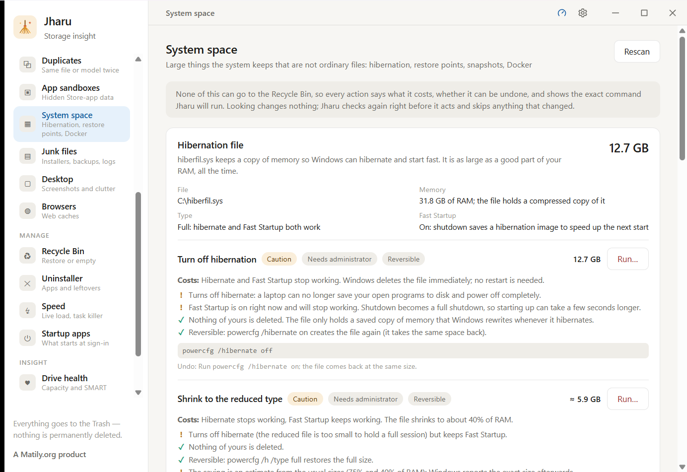

<div align="center">


# Jharu

**Free, open source disk cleaner and storage analyzer for developers — macOS and Windows**

Jharu finds and safely removes the gigabytes that development tools leave behind: machine learning model caches, package manager caches, Docker data, leftovers from uninstalled apps, and forgotten junk files — all from one professional dashboard.

[](https://jharu.matily.org)
[](https://github.com/riponcm/Jharu/stargazers)
[](https://github.com/riponcm/Jharu/releases)
[](LICENSE)
[](#installation)
[](https://tauri.app)


### Download

[](https://github.com/riponcm/Jharu/releases/download/v1.0.0/Jharu_1.0.0_universal.dmg)
&nbsp;
[](https://github.com/riponcm/Jharu/releases/download/v1.0.0/Jharu_1.0.0_x64-setup.exe)

macOS installer is universal (Apple Silicon and Intel). Windows installer is 64-bit.
<br />
Current version: **v1.0.0** · [All releases and release notes](https://github.com/riponcm/Jharu/releases)

</div>

## What is Jharu?

Jharu is a desktop disk cleanup app built specifically for software developers and machine learning engineers. Generic disk space analyzers show you folder sizes; Jharu understands what the data actually is. It ships a knowledge base of known cache and data locations, classifies everything it finds, explains each item in plain language, rates how safe it is to delete, and moves removed data to the Trash or Recycle Bin — never a permanent delete.

Typical problems Jharu solves:

- Disk full after downloading machine learning models with Hugging Face, Ollama, PyTorch, or Whisper
- Gigabytes hidden in npm, pip, uv, yarn, pnpm, conda, Cargo, Go, Gradle, Maven, and NuGet caches
- Leftover settings, caches, and support files from apps you uninstalled long ago
- Old installers, phone backups, logs, and large files you have not touched in months
- Not knowing what is actually using your disk space

## Watch the demo

See a scan, a plain-English breakdown, and a click to clean — with the real numbers from a real machine.

<div align="center">

[](https://www.youtube.com/watch?v=pF8etchkChI)

<em>▶ Watch on YouTube — reclaiming gigabytes in under a minute</em>

</div>

## Screenshots

<div align="center">



<em>Overview — every drive, what is safe to clean now, and where the rest of the space sits</em>

<br /><br />


<em>Dev clean — every known cache location, sized and rated</em>

<br /><br />



<em>ML models — 21.1 GB of the 21.7 GB here was downloaded and never loaded once</em>

<br /><br />



<em>Deep clean — folders sized by what they hold, and an honest notice about what could not be read</em>

<br /><br />



<em>AI tools — caches from Claude Code, Codex, Cursor and others, kept apart from history you cannot get back</em>

<br /><br />



<em>Git worktrees — spare checkouts left by coding agents, and which ones git confirms are merged</em>

<br /><br />



<em>Speed — live load and a careful task killer that asks a program to close before forcing it</em>

<br /><br />


<em>The floating gadget — CPU, memory and free space, always on top</em>

<br /><br />



<em>System space — hibernation, restore points and Docker, with the cost, the undo and the exact command</em>

</div>

## Features

**Overview.**
The page Jharu opens on. A ring for every drive with when it fills up, what Jharu has saved (from its Recycle Bin log, week by week), what can be cleaned right now split into safe, with care and review first, live CPU and memory, a map of where the system drive's space goes (from the last Deep clean of it), and the latest cleans. A small card asks for a GitHub star or a share, and leads with what Jharu has saved once that passes a gigabyte; closing it or starring hides it for good.

**ML models — keep what you use, remove what you never loaded.**
Every downloaded model listed individually, across Hugging Face, Ollama, Whisper, PyTorch and Keras. Jharu distinguishes models you have actually loaded from models that were downloaded once and never opened since, so you can reclaim the second kind without touching the first. Ollama layers shared between models are kept, so removing one model never breaks another. No other cleaner makes this distinction.

**Dev clean.**
Scans 25+ known developer and machine learning cache locations — Hugging Face, Ollama, PyTorch, Whisper, LM Studio, conda, pip, uv, npm, yarn, pnpm, Cargo, Go modules, Gradle, Maven, NuGet, Homebrew, Xcode DerivedData, Docker, JetBrains, Playwright, Puppeteer — with per-item safety ratings and staleness detection.

**Python environments.**
Finds every virtualenv and conda environment, sizes the packages inside them, and shows what duplication costs across environments — the "torch is installed eleven times" problem, quantified.

**Git worktrees.**
Finds the spare checkouts that `git worktree`, Claude Code and Codex leave behind, each one a full copy of its repository. Jharu asks git whether each worktree's commits are already on the main branch and whether anything is uncommitted, ignores files that differ only in line endings, and preselects only the merged, clean ones. Worktrees with unmerged commits or uncommitted files are kept, with the exact commits and files listed. Branches are never deleted, so any removed worktree can be recreated with `git worktree add`.

**Build folders.**
Finds build output inside your projects, in the way of npkill and kondo, but a folder is offered only when the project beside it confirms what it is: `node_modules` next to a `package.json`, Rust `target` next to a `Cargo.toml` holding Cargo's `CACHEDIR.TAG`, `dist` or `build` only when `.gitignore` lists them and the project has a build command, plus `.next`, `.nuxt`, `__pycache__`, `.pytest_cache`, `.mypy_cache`, `.tox`, Gradle `build` and `.gradle`, `.dart_tool`, `Pods`, CMake build folders and `.venv`. Each project shows when its own source files last changed (not its build output), each folder shows the real space freed and the command that brings it back. Safe means the build rebuilds it by itself or a lockfile makes the reinstall identical; virtualenvs and CMake folders are Caution, and anything a dev server or build tool is running from, or whose lock file is held, is skipped. Sort by size, filter by projects untouched for 30, 90 or 180 days, add your own search folders. Removal goes to the Trash or Recycle Bin with progress and a Cancel button.

**AI tools.**
Finds what AI coding assistants leave behind, tool by tool: Claude Code and the Claude desktop app, OpenAI Codex, Cursor, Windsurf (Codeium), GitHub Copilot in VS Code, Continue and Aider. Caches, logs and downloads that the tool rebuilds are rated safe once the tool is closed and held back while it runs. Conversation transcripts, memory, settings and extensions are rated risky: they are listed with size and age, never preselected, and old sessions can be trimmed with an "older than N days" choice (today's are never touched, and a project's memory notes are left alone). An editor's per-project storage is flagged "project folder is gone" when the project no longer exists, and left alone when it does. Aider's files inside your projects are only listed. Each item is checked again just before it moves to the Recycle Bin or Trash, with progress and a Cancel button; spare git checkouts are left to the Git worktrees tab.

**Duplicates.**
Finds identical files in the folders you choose (default: Documents, Downloads, Desktop, Pictures, Videos, Music) and the same model or package stored by several tools: Hugging Face, Ollama, LM Studio, PyTorch, and the pip, uv and conda caches. Files are grouped by size, then compared by their first and last 64 KB, and only the survivors are read in full and hashed (BLAKE3), so nothing is called a duplicate by name, size or date. Hard links, which are several names for one file, are not duplicates and are listed separately as already sharing space; cloud placeholders that are stored only online are never read. Each set keeps one copy (the one whose tool is running, or the one outside Downloads, then the oldest — you can change it) and moves the others to the Trash or Recycle Bin after re-reading both and comparing hashes again. Every copy carries a safety rating with reasons: tool-cache copies are rated like Dev clean, your own files are Caution, copies inside a Git repository, app or Python environment are never removed, and files in OneDrive, iCloud or Dropbox are Risky. The scan and the removal show progress and can be cancelled.

**App sandboxes.**
Store and other packaged (MSIX) apps on Windows keep a private, virtualized copy of AppData in `%LOCALAPPDATA%\Packages\<app>`, which Explorer and most cleaners never show; one app's package held 86 GB of dev caches, build folders and recordings. Jharu lists every package with its app name, whether the app is still installed, whether it is running, its real size and a breakdown by area. Temp and web-cache folders are Safe only while the app is not running; the app's own data (`LocalState`, `Settings`) is Risky and never offered; packages whose app was removed are Caution. Inside `LocalCache`, Dev clean's rules and Deep clean's verdicts rate each folder exactly as they would the real one (a uv cache there is a uv cache). Only the rated folders move to the Recycle Bin, each re-checked just before, with progress and a Cancel button. On macOS the same applies to `~/Library/Containers` and `~/Library/Group Containers`.

**System space.**
Shows the big things the operating system keeps that no folder scan can offer to clean, each with its current size, what turning it off costs, a safety rating with the reasons, and the exact command Jharu will run. On Windows: the hibernation file (turn off, or shrink to the reduced type), System Restore points (delete the oldest, or all but the newest), the component store / WinSxS (analyzed with DISM on request, cleaned with `/StartComponentCleanup`, never `/ResetBase`), the page file (information only; Jharu never changes it) and Docker. On macOS: Time Machine local snapshots, the sleep image (information only) and Docker. Docker offers `docker system prune` (stopped containers, unused networks, dangling images, unused build cache; volumes untouched) and, as a separate option labelled risky, the same with `--volumes`. These are not files, so they cannot go to the Recycle Bin or Trash: every action that cannot be undone says so and asks for confirmation, and the administrator steps run through a helper that accepts only a fixed list of action ids, never a command line. Looking at restore points and the component store needs administrator permission, so it waits for a click.

**Recycle Bin.**
Shows what is in the Recycle Bin (Trash on macOS) with its original location, deletion time and size, split into what Jharu moved there and your own deleted files, each rated with the reasons why. Empty everything, items older than N days, or only Jharu's own items older than N days; emptying is permanent, so it asks with the exact total first and re-checks every item right before it goes. Jharu also keeps a log of everything it sends to the bin (`trash-log.jsonl` under the app's local data folder) with one-click restore, which never overwrites a file that is already in the original place and keeps file extensions intact.

**Deep clean.**
Full-disk analysis as a treemap or a list, with results as they come in. Folders are sized by what they hold, classified as system, applications, your files, app data or developer data, and each one carries a safety rating with the reasons. The Map view draws the current level as a squarified treemap: box area is size on disk and colour is the safety rating, with the reasons in the tooltip; click or press Enter to go inside, and every box can be reached from the keyboard. Folders Jharu cannot read are named above the map instead of quietly left out. System locations are protected and can never be cleaned from the app.

**Junk files.**
Non-cache junk: installers and archives in Downloads, old device backups, logs and crash reports, mail attachment copies, large files untouched for six months, and on Windows the temp folders, Windows Update cache, Delivery Optimization files and crash dumps.

**Desktop.**
Screenshots and clutter on your desktop, filterable by type and age. Because these are your own files, archiving them to a folder is the default action rather than deleting.

**Browsers.**
Detects Chrome, Edge, Brave, Arc, Firefox and Safari, and itemizes their caches per profile, separating safe-to-clear cache from data that deserves review.

**Uninstaller.**
Lists installed applications with both their own size and the data they have accumulated across the system. On Windows it reads the registry and runs each program's own uninstaller; on macOS it removes the bundle. Either way it then sweeps the leftovers, with high-confidence matches preselected.

**Drive health.**
Capacity and SMART status per drive, plus a fill forecast built from a daily capacity reading that projects when a drive will run out of space. Wear level, temperature and power-on hours are shown when `smartctl` is available.

**Space history.**
Remembers where the space is. After each Deep clean scan of a drive or your home folder, and every few hours in the background, Jharu stores a compact snapshot (used and free space per drive, plus the sizes of the largest folders three levels deep, 90 days, thinned to daily). The tab then answers "what grew since last time": the folders that grew or shrank most between two snapshots, the drive's change in free space, and Deep clean's safe-to-remove rating for each grown folder. A forecast fits the last 30 days of free space (the median of the day-to-day trend, so one cleanup does not distort it) and says when a drive fills up, or says plainly that there is not enough data or that space is not shrinking. The same sentence appears on Drive health. It can also send a system notification when a drive drops below a free-space limit you set. Optional scheduled cleaning, off by default, clears only Dev clean caches that are rated Safe, that their tool rebuilds by itself and that nothing has touched for a number of days; each is checked again right before it moves to the Recycle Bin or Trash, nothing runs during a scan or clean, and every run is written to the history.

**Startup apps.**
Lists what starts when you sign in: Run keys, Startup folders and logon tasks on Windows, LaunchAgents, LaunchDaemons and login items on macOS (listing only on macOS). Each entry shows its publisher, command, whether its program still exists, and an estimated impact from file size and what is running now. Entries whose program is gone are rated safe to turn off; updaters and unfamiliar programs need a look; security software, hardware drivers and Windows or Apple components are protected and never offered. Turning an entry off flips the same StartupApproved flag Task Manager uses, so it is always reversible and the entry is never deleted. Machine-wide entries ask for administrator permission once.

**Speed (task killer).**
A live bar of CPU, memory, swap, disk activity and process count, refreshed every two seconds while the tab is open, above the running programs grouped by program (a browser is one row, not forty) and sortable by CPU, memory or disk. Each row has a rating and the reasons for it: system processes, security software, drivers, anything under the Windows or macOS system folders, Jharu itself and the programs that started it, other users' processes and anything whose owner Jharu cannot read are protected and offer no action; programs with a window, an editor, office app, browser or terminal, a program with other programs started from it, a helper that another running program started, or a window that is not responding are Caution; only a program with no window, nothing started from it and nothing else running that started it is Safe, and it is still only closed when you click. **Close** is graceful: on Windows it posts the same close request as the window's X button (the program can ask you to save), on macOS it asks the app to quit the way the Dock does (a program that is not an app gets SIGTERM), then waits up to five seconds and says which processes ended. A program with no window says so and offers **Force quit**, which asks a second time and says plainly that anything unsaved is lost. Jharu never closes programs in bulk or on its own, and checks every process again right before signalling (same pid, start time, program and user, still not protected) so a recycled process number is never hit. On macOS an app's helper processes are listed, and closed, with the app.

**Floating gadget.**
Optional and off until you turn it on (About or Speed). A small black always-on-top window with ring gauges, either a slim bar (CPU, memory, free space on the system drive and when it runs out) or a card that adds the busiest programs and one button to clean safe caches, which shows what it would move and asks first. Drag it anywhere; it reopens where you left it, and its ✕ turns it off. It reads a few numbers every two seconds and never scans the disk in the background.

**In-app updates.**
Jharu checks GitHub releases for new versions and downloads and installs them from inside the app — signed, verified, and with a one-click restart.

## How Jharu compares

Generic cleaners are built to look busy and sell a subscription. Jharu does one thing deeply: the developer and AI data no general-purpose cleaner understands.

| | Jharu | CleanMyMac | CCleaner |
| --- | --- | --- | --- |
| Price | **Free forever** | $40+/yr | Freemium |
| Open source | **Yes · Apache 2.0** | No | No |
| Understands ML model caches | **Yes** | No | No |
| Used vs never-loaded detection | **Yes** | No | No |
| Telemetry / tracking | **None** | Yes | Yes |
| macOS and Windows | **Both** | macOS only | Both |
| Registry "cleaner" | **Never (it does not work)** | — | Yes |

## What can Jharu clean?

| Category | Examples |
| --- | --- |
| ML model caches | Hugging Face hub (`~/.cache/huggingface`), Ollama models (`~/.ollama/models`), PyTorch hub, Whisper, Keras, LM Studio |
| Python | pip cache, uv cache, conda package cache, stale conda environments |
| JavaScript | npm cache (`~/.npm/_cacache`), yarn cache, pnpm store, Puppeteer and Playwright browser downloads |
| Build tools | Xcode DerivedData and archives, Gradle caches, Maven repository, Cargo registry, Go module cache, NuGet packages |
| AI coding tools | Claude Code (`~/.claude`), Claude desktop caches and logs, Codex (`~/.codex`), Cursor and Windsurf app data, Copilot and other editor caches, Continue (`~/.continue`), Aider history files |
| Git worktrees | Merged worktree folders from `git worktree`, Claude Code (`<repo>/.claude/worktrees`) and Codex (`~/.codex/worktrees`), plus stale worktree records (`git worktree prune`) |
| Project build folders | `node_modules`, Rust `target`, `.next`, `.nuxt`, `dist`/`build` (when `.gitignore` confirms), `__pycache__`, pytest/mypy/tox caches, Gradle, Dart, CocoaPods and CMake build folders, and project `.venv`s |
| App sandboxes | Temp, web cache and caches inside the private folders of Store/MSIX apps (`%LOCALAPPDATA%\Packages`) and sandboxed Mac apps (`~/Library/Containers`), plus the data of apps you already removed |
| Containers | Docker VM data and image storage, `docker system prune` |
| System space | Hibernation file, System Restore points, component store (WinSxS), Time Machine local snapshots |
| IDEs | JetBrains caches, editor cache directories |
| App leftovers | Support files, caches, preferences, and logs from uninstalled applications |
| Junk | Installers in Downloads, old device backups, crash reports, mail attachment copies, large stale files |

## Safety model

- Nothing is ever permanently deleted. Every clean action moves data to the Trash or Recycle Bin, where it can be restored. The one exception is System space, whose targets are not files (restore points, snapshots, Docker data, the hibernation setting): each of those actions says whether it can be undone and needs its own confirmation.
- Every finding carries a safety rating: safe to clear, re-downloadable, or review first.
- Operating system locations are protected and excluded from cleaning entirely.
- Every clean is confirmed by a dialog that states the actual consequence — a cache rebuilds itself, a model is re-downloaded, an environment must be recreated, your own files are gone for good.
- **A location Jharu cannot read is reported, never hidden.** A folder needing elevated rights measures 0 B, which looks exactly like an empty one; Jharu flags these as partly unreadable instead of quietly leaving them out. A cleaner that hides what it cannot see is worse than one that admits it.
- No registry cleaner, and Windows prefetch is listed but never cleaned. Both are widely marketed and neither does anything useful; prefetch is how Windows starts your apps quickly, and clearing it makes the next launches slower.

## Installation

Prebuilt installers for macOS (Apple Silicon and Intel) and Windows are published on the [releases page](https://github.com/riponcm/Jharu/releases). Once installed, Jharu updates itself in-app.

### Build from source

Prerequisites: [Rust](https://rustup.rs) (stable) and [Node.js](https://nodejs.org) 20+.

```sh
git clone https://github.com/riponcm/Jharu.git
cd Jharu
npm install
npm run tauri dev      # run in development
npm run tauri build    # produce installers for your platform
```

On macOS, grant Full Disk Access (System Settings, Privacy and Security) for complete scan coverage. Jharu detects missing access and offers to open the right settings pane.

### Opening Jharu the first time

From version 1.0.0, Jharu is signed on both platforms: the Mac app with an Apple Developer ID and notarized by Apple, and the Windows installer through Azure Artifact Signing. It opens like any other app, and every in-app update is verified by a cryptographic signature too.

- **macOS:** opens normally. Versions before 1.0.0 were unsigned; if one shows "Jharu cannot be opened because Apple cannot verify it", right-click (or Control-click) the app and choose **Open**, then confirm.
- **Windows:** the installer names the publisher. While a new signature builds its reputation, SmartScreen may still show "Windows protected your PC" for a while; click **More info** to see the publisher, then **Run anyway**.

## Frequently asked questions

**How do I clear the Hugging Face model cache?**
Open Jharu's Dev clean tab. It lists your Hugging Face hub cache (`~/.cache/huggingface`) with its exact size and lets you explore it or move it to the Trash. Models are re-downloaded automatically the next time a library requests them.

**Is it safe to delete npm, pip, or other package manager caches?**
Yes. These caches only speed up reinstalls and are rebuilt automatically on the next install. Jharu marks them "Safe to clear". Deleting an active project's `node_modules` or a conda environment you still use is different — Jharu rates those "Review first".

**How do I clean up old git worktrees left by Claude Code or Codex?**
Open Jharu's Git worktrees tab. It lists every worktree of every repository it finds, with its size, branch, and last commit, and says whether its work is already on the main branch. Merged, clean worktrees are preselected; removing them moves the folders to the Trash or Recycle Bin and runs `git worktree prune`. Worktrees a tool created for a session are never preselected, because the tool may still be using them.

**Does Jharu permanently delete my files?**
No. Every clean action moves data to the macOS Trash or Windows Recycle Bin, where it can be restored. Jharu never bypasses the Trash.

**Is Jharu a free alternative to CleanMyMac or CCleaner?**
Yes. Jharu is free and open source under the Apache 2.0 license, with no subscription, telemetry, or upsell. Its focus is narrower and deeper: developer and machine learning data that general-purpose cleaners do not understand.

**How do I find out what is taking up disk space on my Mac or Windows PC?**
Jharu's Deep clean tab analyzes the whole disk and shows every folder's real size, classified by what it is — system files, applications, your documents, app data, or developer data — so you can tell junk from data that matters.

**How do I completely uninstall an app, including leftover files?**
Jharu's Uninstaller lists every installed app together with the data it has accumulated. Uninstalling removes the app and its leftover support files, caches, and preferences in one step.

## Architecture

| Layer | Technology |
| --- | --- |
| Scanner | Rust with parallel directory walking (`jwalk`) |
| Safety | OS trash integration (`trash`), never permanent deletion |
| Rules | Per-platform knowledge base of cache and data locations |
| UI | React and TypeScript, Tauri 2 WebView |
| Updates | `tauri-plugin-updater` with signed GitHub release artifacts |
| Drive info | `sysinfo`, with SMART via `diskutil` and optional `smartctl` |
| Windows | `winreg` for the uninstall keys; per-platform paths throughout |
| Trend | A daily capacity reading stored locally, fitted by least squares |

## Roadmap

- Orphaned-data detection by comparing leftover folders against installed applications
- Detailed drive health on Windows, which currently reports capacity only
- Localized UI, starting with Bengali and Hindi

Shipped in 0.2.0: per-model ML intelligence, Python environment analysis, the
desktop cleaner, Windows uninstaller and junk rules, the deep clean treemap and
the fill forecast. Shipped in 1.0.0: the overview, git worktrees, build
folders, AI tools, duplicates, app sandboxes, system space, the Recycle Bin
and Trash, space history, startup apps, the task killer and the floating
gadget. See the [changelog](CHANGELOG.md).

## Support Jharu

Jharu is free, open source, and has no ads, telemetry, or paid tier — and it always will. But shipping a desktop app that users can install without scary security warnings costs real money every year, and that is the one thing an individual developer cannot absorb alone:

| What it pays for | Cost |
| --- | --- |
| **Apple notarization** — removes the "Apple cannot verify this app" warning on every Mac | 99 USD / year (Apple Developer Program) |
| **Windows code signing** — shows the publisher instead of "Unknown publisher" | ~120 USD / year (Azure Artifact Signing) |

Both are now paid for out of pocket, and every star and every sponsorship goes directly toward keeping them renewed. If Jharu reclaimed gigabytes of your disk, here is how you can pay it forward in seconds:

- **Star the repository.** It is free, it takes one click, and it is the single biggest thing that helps other developers discover Jharu.
- **Sponsor the project.** Even a one-time contribution the size of a coffee helps cover the signing certificates that make Jharu safe and frictionless for everyone to install. Use the **Sponsor** button at the top of this repository.
- **Spread the word.** Share Jharu with a teammate whose disk is always full, or post about it — reach is what turns a side project into a maintained tool.

Your support keeps every release installing cleanly on macOS and Windows. Thank you for helping keep Jharu free and independent.

## Contributing

Issues and pull requests are welcome. For substantial changes, open an issue first to discuss the approach. New cache locations for the knowledge base are especially appreciated — include the path per platform, what writes it, and whether it regenerates.

## License

Licensed under the [Apache License 2.0](LICENSE).

## Acknowledgements

Jharu draws inspiration from the open source projects ClearDisk, Pearcleaner, PureMac, SquirrelDisk, and kondo.

---

<div align="center">

A [Matily.org](https://matily.org) product. Built with Projectmem memory.

</div>
